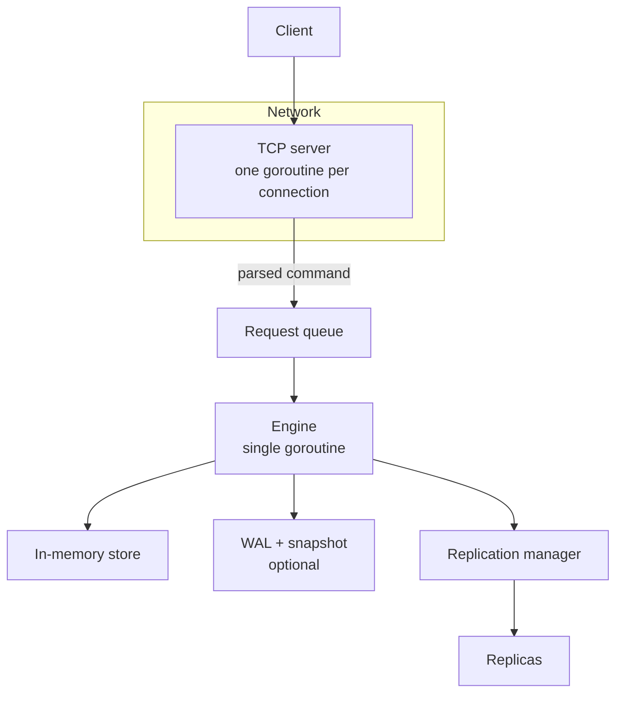

# MemKV

MemKV is an in-memory key-value store written in Go. It speaks a subset of the Redis protocol (RESP2), so you can talk to it with `redis-cli`.

Features:

- Five data types: strings, sets, lists, hashes, and sorted sets.
- Key expiration (TTL).
- Transactions with `MULTI` / `EXEC` / `WATCH`.
- Optional persistence to disk (write-ahead log and snapshots).
- Asynchronous primary → replica replication.

## Architecture



### One engine, no locks

Each client connection gets its own goroutine that parses commands and sends replies. Parsed commands go into a bounded queue, and **a single engine goroutine executes them one by one**.

Because only the engine touches the data, the store needs no locks, and every command sees a consistent state. The trade-offs:

- A slow command delays the commands behind it.
- When the queue is full, clients wait (backpressure).

Networking, disk I/O, and replication still run in other goroutines, so MemKV is not single-threaded overall.

### Store

Each key holds one entry with a type, a value, a version number, and an optional expiration time.

| Type       | Implementation                         |
| ---------- | -------------------------------------- |
| String     | Plain value                            |
| Set        | Hash set                               |
| List       | Circular deque that grows as needed    |
| Hash       | Hash map of field → value              |
| Sorted set | Score map plus a sorted slice          |

- **Versions**: every write bumps the key's version. `WATCH` uses this to detect conflicts.
- **Expiration**: expired keys are removed when accessed, and also in small background batches.
- **Eviction**: if `memory.max_keys` is set, creating a new key beyond the limit deletes the oldest key (FIFO).
- **Sorted sets** rebuild their sorted slice on each change (`O(n log n)`), which keeps the code simple but is slow for very large sets.

### Persistence

Both mechanisms are optional.

- **WAL (write-ahead log)**: each write is appended to the log and flushed to disk *before* it changes memory. If writing the log fails, the command fails and later writes are rejected. On startup, MemKV replays the log. A half-written last record is trimmed; corruption in the middle stops startup.
- **Snapshot**: the full dataset is saved to a file on graceful shutdown. The snapshot remembers how far into the WAL it covers, so on startup MemKV loads the snapshot and replays only the newer part of the log.

### Replication

- Replication is **asynchronous**: the primary replies to the client without waiting for replicas.
- A new replica receives a full snapshot, then a live stream of writes.
- A replica that reconnects quickly only receives the writes it missed (from an in-memory backlog).
- A replica that falls too far behind is disconnected, so it never slows down the primary.
- Replicas are read-only, do not persist to disk, and cannot be promoted to primary.

### Supported commands

| Category    | Commands                                                |
| ----------- | ------------------------------------------------------- |
| String/TTL  | `SET`, `GET`, `DEL`, `EXPIRE`, `PEXPIREAT`, `TTL`       |
| Set         | `SADD`, `SREM`, `SMEMBERS`, `SISMEMBER`, `SCARD`        |
| List        | `LPUSH`, `RPUSH`, `LPOP`, `RPOP`, `LLEN`, `LRANGE`      |
| Hash        | `HSET`, `HGET`, `HDEL`, `HGETALL`, `HEXISTS`, `HLEN`    |
| Sorted set  | `ZADD`, `ZREM`, `ZSCORE`, `ZRANK`, `ZCARD`, `ZRANGE`    |
| Transaction | `MULTI`, `EXEC`, `DISCARD`, `WATCH`, `UNWATCH`          |
| Server      | `PING`, `AUTH`, `INFO`, `KEYS`, `FLUSHDB`, `FLUSHALL`   |

Not implemented: ACL users, scripting, pub/sub, clustering, sharding, and replica promotion.

## Getting Started

### Requirements

- Go 1.25 or newer
- Make
- `redis-cli` (optional, for trying commands)

### Build

```bash
git clone https://github.com/nolannguyen1212/memkv.git
cd memkv
make build
```

The binary is written to `bin/memkv`.

### Run

Start a primary using `config.yaml`:

```bash
make run
```

Connect with the password from `server.auth`:

```bash
redis-cli -p 6379 -a secretpassword --no-auth-warning
```

```text
127.0.0.1:6379> SET greeting hello
OK
127.0.0.1:6379> GET greeting
"hello"
```

Start the sample replica on port `6380`:

```bash
make replica
redis-cli -p 6380 -a secretpassword --no-auth-warning GET greeting
```

Use other config files with `make run CONFIG=path/to/primary.yaml` or `make replica REPLICA_CONFIG=path/to/replica.yaml`. Each replica needs its own `server.addr`.

### Configuration

MemKV reads a YAML file and rejects unknown fields.

```yaml
server:
  addr: ":6379"
  read_timeout: 300          # seconds
  write_timeout: 300         # seconds
  auth: secretpassword
  resp:
    max_bulk_length: 16777216
    max_array_length: 1024
    max_depth: 8
    max_line_length: 65536

replication:
  role: primary              # primary | replica
  primary_addr: ""           # replica only
  username: ""               # replica only: empty or "default"
  password: ""               # replica only
  backlog_size: 1048576      # bytes

persistence:
  wal:
    enabled: true
    filename: memkv.wal
    rewrite_interval: 3600   # seconds
    max_size_mb: 64
  snapshot:
    enabled: false
    filename: dump.mksp

datastructure:
  expiration:
    check_interval: 1        # seconds

memory:
  max_keys: 5000000          # omit for no limit
```

Notes:

- A replica must set `role: replica`, set `primary_addr` and the primary's credentials, and disable both WAL and snapshot.
- When WAL and snapshot are both enabled, automatic WAL rewrite is turned off.

## Testing

```bash
make test
go test -race -count=1 ./...
go vet ./...
golangci-lint run
```

Fuzz tests:

```bash
go test -run '^$' -fuzz FuzzDecode -fuzztime 30s ./internal/resp
go test -run '^$' -fuzz FuzzDecodeRecord -fuzztime 30s ./internal/wal
go test -run '^$' -fuzz FuzzDecode -fuzztime 30s ./internal/snapshot
go test -run '^$' -fuzz FuzzParseCommand -fuzztime 30s ./internal/server
```
